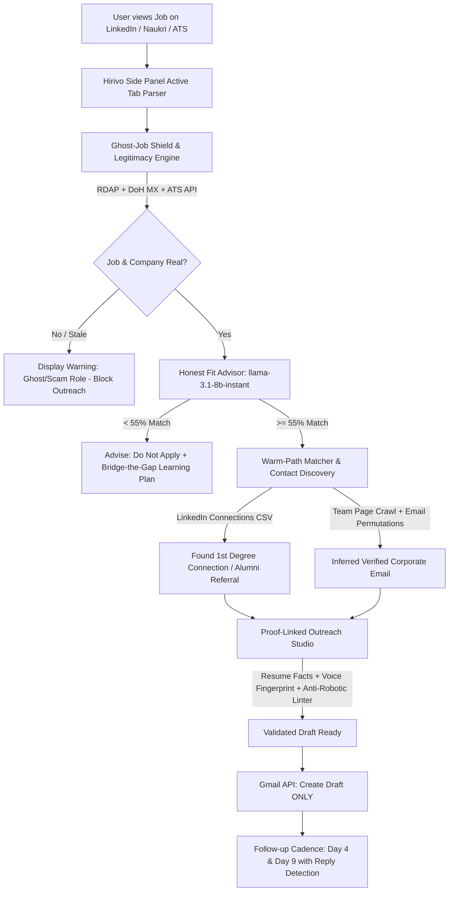
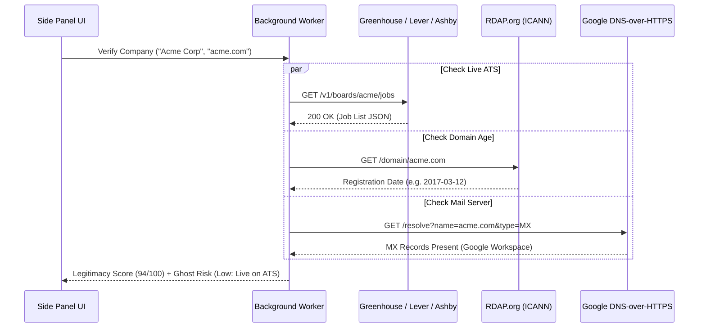

# 🚀 Hirivo: Master Architecture & Implementation Plan
**A Zero-Ban, Local-First, Privacy-Focused Job Outreach Intelligence Extension**

---

## 1. Executive Vision & The Core Moat

Existing tools like **LazyApply** suffer from low credibility (2.1/5 Trustpilot) because they treat job applications as automated spam, triggering aggressive platform bot-detection (over 23% ban rate on LinkedIn). Meanwhile, tools like **Apollo, Clay, and ContactOut** are built for enterprise B2B sales reps and charge $49–$250/mo.

**Hirivo fills the white space**:
1. **Zero-Ban LinkedIn Rule**: Absolutely **no auto-clicks, auto-connects, or auto-sends**. Hirivo operates in a Side Panel, reading DOM elements only when the user is viewing the page. The user remains the human-in-the-loop.
2. **Ghost-Job & Legitimacy Verification**: Blocks wasted outreach by checking public ATS feeds (Greenhouse, Lever, Ashby) and domain RDAP age before writing a single word.
3. **Proof-Linked Grounded Writing**: Kills hallucinated cover letters. Every statement in a draft references an atomic fact from the user's resume (`[FACT-04]`). Unsupported boasts are flagged and blocked.
4. **Warm-Path Advantage**: Ingests the user’s official LinkedIn `Connections.csv` export into local IndexedDB to find 1st-degree connections and alumni at the target company.
5. **100% Free & Local-First (BYOK)**: Zero subscription, zero user telemetry. Powered by a client-side multi-provider router: **Groq (Primary) → Gemini (Fallback) → OpenRouter (Fallback)** with response caching.



---

## 2. Technical Stack & Manifest V3 Compliance

| Layer | Technology | Rationale |
| :--- | :--- | :--- |
| **Framework** | React 19 + TypeScript | Type safety, component modularity, fast UI rendering |
| **Bundler & Build** | Vite + `@crxjs/vite-plugin` (or Multi-entry Rollup) | Hot Module Replacement (HMR) in Chrome extension development |
| **Styling** | Vanilla CSS / TailwindCSS + Lucide Icons | Ultra-fast load times in side panel iframe context |
| **Local Database** | Dexie.js (IndexedDB wrapper) | Structured storage for resumes, fact-nodes, CSV connections, drafts, and cache |
| **Extension Shell** | Chrome Manifest V3 (`sidePanel`) | Modern Chrome extension standard with native docking beside web pages |
| **AI Engine** | BYOK Multi-Provider Router | Groq SDK (`llama-3.1-8b-instant` & `llama-3.3-70b-versatile`), Gemini API, OpenRouter |
| **Network Checks** | Public RDAP, Google/Cloudflare DoH | Free, zero-backend domain age and DNS MX verification |
| **Email Service** | Google Identity & Gmail REST API | `chrome.identity.getAuthToken` for safe draft creation |

### 2.1 Manifest V3 Declaration (`manifest.json`)
```json
{
  "manifest_version": 3,
  "name": "Hirivo - Verified Job Outreach Assistant",
  "version": "1.0.0",
  "description": "Ghost-job verification, honest fit analysis, proof-linked outreach, and warm referral finder.",
  "permissions": [
    "sidePanel",
    "storage",
    "tabs",
    "scripting",
    "identity",
    "alarms"
  ],
  "host_permissions": [
    "https://api.groq.com/*",
    "https://generativelanguage.googleapis.com/*",
    "https://openrouter.ai/*",
    "https://*.rdap.org/*",
    "https://rdap.org/*",
    "https://dns.google/*",
    "https://cloudflare-dns.com/*",
    "https://boards-api.greenhouse.io/*",
    "https://api.lever.co/*",
    "https://api.ashbyhq.com/*",
    "https://gmail.googleapis.com/*",
    "https://*.linkedin.com/*",
    "https://*.naukri.com/*",
    "https://*.indeed.com/*",
    "https://*.wellfound.com/*"
  ],
  "background": {
    "service_worker": "src/background/index.ts",
    "type": "module"
  },
  "side_panel": {
    "default_path": "sidepanel.html"
  },
  "action": {
    "default_title": "Open Hirivo Side Panel"
  },
  "icons": {
    "16": "icons/icon16.png",
    "48": "icons/icon48.png",
    "128": "icons/icon128.png"
  }
}
```

> [!IMPORTANT]
> **Side Panel Launch Behavior**: As mandated by Manifest V3 best practices, the background worker must register `chrome.sidePanel.setPanelBehavior({ openPanelOnActionClick: true })` on startup.

---

## 3. Subsystem Architecture & Implementation

### 3.1 Subsystem 1: Job Page & Resume Extraction Engine
- **Job Extractors**: Runs non-invasive DOM parsers across:
  - LinkedIn (`.job-details-jobs-unified-top-card`, `.jobs-description__content`)
  - Naukri (`.styles_job-header-container`, `.styles_job-desc-container`)
  - Indeed, Wellfound, and direct ATS boards (Greenhouse, Lever, Ashby).
  - Sanitization: Strips EEO boilerplate, legal disclaimers, and 401k/health perks to reduce token consumption by 50%.
- **Resume Fact Ingestion**:
  - Parses uploaded PDF/DOCX/Text into structured fact nodes stored in IndexedDB:
    ```typescript
    interface ResumeFact {
      id: string; // e.g. "FACT-01"
      category: 'METRIC' | 'SKILL' | 'ROLE' | 'PROJECT' | 'EDUCATION';
      text: string; // e.g. "Reduced PostgreSQL p99 query latency by 45% using materialized views"
      sourceSnippet: string;
      confidence: number;
    }
    ```

---

### 3.2 Subsystem 2: Ghost-Job Shield & Company Legitimacy Engine
Operates 100% client-side with zero external paid APIs:



1. **ATS Live Sync**:
   - Greenhouse: `https://boards-api.greenhouse.io/v1/boards/{board_token}/jobs`
   - Lever: `https://api.lever.co/v0/postings/{company_id}?mode=json`
   - Ashby: `https://api.ashbyhq.com/posting-api/job-board/{company_slug}`
   - *Ghost Role Detection*: If a role is marked "Posted 30+ days ago" on LinkedIn but absent from the live ATS feed, flag as `GHOST_JOB_RISK` (85% probability stale/closed).
2. **Domain RDAP Age**:
   - Fetches registration date from `https://rdap.org/domain/{domain}`.
   - Age < 3 months: **Red Flag (Scam Risk)**.
   - Age 3–12 months: **Yellow Caution (New Entity)**.
   - Age > 2 years: **Green Verified (Established)**.
3. **Mail Exchanger (MX) Verification**:
   - Queries `https://dns.google/resolve?name={domain}&type=MX` with `Accept: application/dns-json`.
   - Confirms domain can receive incoming emails before the user drafts outreach.

---

### 3.3 Subsystem 3: Honest Fit Advisor & Multi-Provider LLM Router
- **Fit Scoring Model**: `llama-3.1-8b-instant` on Groq (fast inference, ~500 tokens/sec, low quota usage).
- **Brutally Honest Advice**:
  - `matchScore >= 80%`: **Strong Fit** → Proceed to outreach.
  - `55% <= matchScore < 80%`: **Moderate Fit** → Highlight specific edge qualifications.
  - `matchScore < 55%`: **Do Not Apply** → Display:
    > "Match is 32%. This role requires 5+ years of Go concurrency in production; your resume shows 1 year of frontend React. Outreach here will burn your daily cap. Instead, spend time building [Recommended Project] or mastering [Skill]."

#### Multi-Provider Router with SHA-256 Caching
```typescript
export class LLMRouter {
  private providers: LLMProvider[];
  private cache: LocalCacheStore;

  async generate(prompt: string, systemPrompt: string, options: RouterOptions): Promise<string> {
    const cacheKey = await this.computeHash(prompt + systemPrompt + options.task);
    const cached = await this.cache.get(cacheKey);
    if (cached) return cached.response;

    // Failover: Groq -> Gemini Free -> OpenRouter Free
    for (const provider of this.providers) {
      try {
        if (!provider.isConfigured()) continue;
        const res = await provider.complete(prompt, systemPrompt, options);
        await this.cache.set(cacheKey, res, 7 * 24 * 3600); // 7 day TTL
        return res;
      } catch (err: any) {
        if (err.status === 429 || err.status === 503) {
          console.warn(`Provider ${provider.id} rate limited. Failing over...`);
          continue;
        }
        throw err;
      }
    }
    throw new Error("All configured LLM providers failed or exceeded rate limits.");
  }
}
```

---

### 3.4 Subsystem 4: Proof-Linked Writing, Voice Fingerprint & Linter

#### 1. Proof-Linked Claim Engine
Every sentence generated by the model must cite a fact tag `[FACT-xx]` defined in the user's active resume profile:
- Example Output: `"At FinCorp, I redesigned our Redis cache layer, reducing 95th percentile latency by 38% [FACT-03]."`
- **Client-Side Validator**:
  1. Parses output into sentences.
  2. Scans for fact tokens `\[FACT-(\d+)\]`.
  3. Verifies that the cited fact exists in IndexedDB and matches the assertion.
  4. If a sentence makes an ungrounded claim (e.g., `"I have extensive experience leading 50-person orgs"` without a fact tag), it is flagged in red as `UNVERIFIED_CLAIM`.
  5. The UI prevents one-click drafting until unverified claims are reviewed or removed.

#### 2. Voice Fingerprint Calibration
User pastes 3–5 of their own sent emails. The engine computes:
- Average sentence length (e.g. 11.4 words)
- Contraction density (e.g. "I'm", "we'll" vs "I am", "we will")
- Preferred greeting (`"Hi [Name],"` vs `"Hey [Name],"` vs `"Dear [Name],"`)
- Preferred sign-off (`"Best,"` vs `"Cheers,"` vs `"Thanks,"`)
- Punctuation habits (em-dash usage, bullet density)
These stylistic parameters are dynamically injected into the writing prompt.

#### 3. Banned-Phrase Linter
Deterministic regex engine screening out 50+ robotic AI clichés:
- ❌ *"I hope this email finds you well"* → 💡 Direct context opening
- ❌ *"I am writing to express my keen interest in..."* → 💡 Cut to the point
- ❌ *"delve", "testament to", "game-changer", "spearheaded", "synergy", "rockstar"* → 💡 Replaced with concrete human vocabulary.

---

### 3.5 Subsystem 5: Warm-Path Finder & Contact Discovery

```
[LinkedIn Settings] ──> [Download Connections.csv] ──> [Hirivo Local Import]
                                                              │
                                                              ▼
[Viewing Job at "Razorpay"] ─────────> [IndexedDB Query: Company="Razorpay"]
                                                              │
                                                              ▼
                                              ┌───────────────────────────────┐
                                              │ 🎉 2 Warm Connections Found:  │
                                              │ • Alex M. (Staff Eng, 2022)   │
                                              │ • Priya K. (Eng Manager, 2023)│
                                              └──────────────┬────────────────┘
                                                             │
                                                             ▼
                                              [1-Click Draft Warm Referral]
```

1. **Warm-Path CSV Matcher**:
   - Parses standard LinkedIn export (`First Name, Last Name, URL, Email Address, Company, Position, Connected On`).
   - All data remains private in local IndexedDB.
   - When user views a job, matches connections at the company and alumni from their university.
   - Drafts a warm referral request (10x higher response rate than cold outreach, 0% ban risk).
2. **Open-Web Contact Discovery**:
   - Crawls target company public team pages (`/about`, `/team`, `/people`, `/leadership`).
   - Identifies engineering/product leadership names.
   - Generates standard enterprise permutations:
     - `{first}.{last}@{domain}`
     - `{first}@{domain}`
     - `{f}{last}@{domain}`
   - Validates domain MX records via DoH.

---

### 3.6 Subsystem 6: Gmail Drafts Autopilot & Follow-up Cadence
- **Zero Auto-Send Principle**: Only creates drafts via `https://www.googleapis.com/gmail/v1/users/me/drafts`. The user opens Gmail, reviews the draft, and clicks send.
- **Cadence Rules**:
  - **Day 0**: Initial outreach draft created.
  - **Day 4**: Follow-up 1 draft created in the same thread (`threadId`), polite context bump.
  - **Day 9**: Follow-up 2 draft created, graceful breakup/closure note.
- **Reply Detection**:
  - Background alarm checks `GET /gmail/v1/users/me/threads/{threadId}` every 4 hours.
  - If a reply from the recipient is detected:
    - Status changes to `REPLIED`.
    - Automatically cancels and removes pending follow-up drafts!
- **Daily Send Cap**: Default max 15 drafts/day to preserve sender domain reputation.

---

## 4. Database Schema (IndexedDB / Dexie.js)

```typescript
export interface HirivoDB extends Dexie {
  resumes: Dexie.Table<ResumeRecord, string>;
  facts: Dexie.Table<ResumeFact, string>;
  connections: Dexie.Table<LinkedInConnection, string>;
  jobSnapshots: Dexie.Table<JobSnapshot, string>;
  outreachThreads: Dexie.Table<OutreachThread, string>;
  voiceProfiles: Dexie.Table<VoiceProfile, string>;
  llmCache: Dexie.Table<LLMCacheItem, string>;
}

export interface OutreachThread {
  id: string; // UUID
  companyName: string;
  companyDomain: string;
  jobTitle: string;
  jobUrl: string;
  recipientName: string;
  recipientEmail: string;
  contactType: 'WARM_CONNECTION' | 'ALUMNI' | 'COLD_HIRING_MGR';
  gmailThreadId?: string;
  status: 'DRAFT_CREATED' | 'SENT' | 'FOLLOWUP_1_DUE' | 'FOLLOWUP_2_DUE' | 'REPLIED' | 'CLOSED';
  createdAt: number;
  followup1Date: number; // createdAt + 4 days
  followup2Date: number; // createdAt + 9 days
  factsUsed: string[]; // ['FACT-01', 'FACT-04']
  notes: string;
}
```

---

## 5. File & Directory Layout

```
Hirivo/
├── manifest.json
├── package.json
├── tsconfig.json
├── vite.config.ts
├── tailwind.config.js
├── public/
│   └── icons/
│       ├── icon16.png
│       ├── icon48.png
│       └── icon128.png
├── src/
│   ├── background/
│   │   ├── index.ts               // Service worker lifecycle & alarms
│   │   ├── gmailService.ts        // Gmail drafts & reply polling
│   │   └── rdapService.ts         // Domain age & DoH MX checking
│   ├── content/
│   │   ├── index.ts               // Content script orchestrator
│   │   ├── extractors/
│   │   │   ├── linkedin.ts        // Read-only LinkedIn parser
│   │   │   ├── naukri.ts          // Naukri job parser
│   │   │   ├── wellfound.ts       // Wellfound parser
│   │   │   └── genericAts.ts      // Greenhouse/Lever/Ashby parser
│   ├── db/
│   │   ├── index.ts               // Dexie database definition
│   │   └── migrations.ts
│   ├── llm/
│   │   ├── router.ts              // Multi-provider router
│   │   ├── cache.ts               // SHA-256 prompt response cache
│   │   ├── providers/
│   │   │   ├── groq.ts            // Groq API (llama-3.1-8b / 3.3-70b)
│   │   │   ├── gemini.ts          // Google Gemini Free Tier
│   │   │   └── openrouter.ts      // OpenRouter Free Models
│   │   └── prompts/
│   │       ├── fitAdvisor.ts      // Honest fit scoring prompt
│   │       ├── proofWriter.ts     // Fact-grounded outreach prompt
│   │       └── referralWriter.ts  // Warm referral ask prompt
│   ├── services/
│   │   ├── ghostJobShield.ts      // Public ATS comparator
│   │   ├── legitimacyScorer.ts    // Domain age + MX score
│   │   ├── voiceFingerprint.ts    // Stylometric analyzer
│   │   ├── phraseLinter.ts        // Banned robotic phrase linter
│   │   ├── warmPathMatcher.ts     // LinkedIn CSV matcher
│   │   └── contactInference.ts    // Email permutation & MX test
│   └── sidepanel/
│       ├── index.html
│       ├── main.tsx
│       ├── App.tsx
│       ├── components/
│       │   ├── JobOverviewTab.tsx  // Fit score & Ghost status
│       │   ├── ProofWriterTab.tsx  // Grounded editor & Linter
│       │   ├── WarmPathTab.tsx     // 1st-degree referrals
│       │   ├── TrackerTab.tsx      // Day 4/9 followups & replies
│       │   └── SettingsTab.tsx     // BYOK & Resume upload
│       └── styles/
│           └── globals.css
```

---

## 6. Phased Implementation Roadmap

### Phase 1: Foundation & Safe Side Panel (Week 1)
- [x] Architecture design & sequential validation.
- [ ] Initialize Vite + React + TypeScript + Manifest V3 structure.
- [ ] Configure `sidePanel` and background service worker with `openPanelOnActionClick`.
- [ ] Implement Dexie.js database schema and settings storage.
- [ ] Setup Settings UI for BYOK keys (Groq, Gemini, OpenRouter) and resume text/fact ingestion.

### Phase 2: Parsers, Ghost-Job Shield & Fit Advisor (Week 2)
- [ ] Build content script parsers for LinkedIn, Naukri, and ATS job pages.
- [ ] Implement Ghost-Job Shield (Greenhouse/Lever/Ashby public board queries).
- [ ] Implement Domain RDAP age and Google DoH MX record checks.
- [ ] Implement LLM Router (Groq with Gemini/OpenRouter failover) + SHA-256 caching.
- [ ] Implement Honest Fit Advisor with `llama-3.1-8b-instant` and "Don't Apply" guidance.

### Phase 3: Proof-Linked Writing, Voice Fingerprint & Linter (Week 3)
- [ ] Build atomic resume fact tagger (`[FACT-xx]`).
- [ ] Implement proof-grounded generation prompt with strict citation constraints.
- [ ] Build client-side verification engine flagging ungrounded claims in red.
- [ ] Implement stylometric voice calibrator from pasted samples.
- [ ] Implement real-time banned-phrase regex linter with human-sounding replacements.

### Phase 4: Warm-Path Finder & Contact Discovery (Week 4)
- [ ] Implement LinkedIn `Connections.csv` parser with local IndexedDB indexing.
- [ ] Build fuzzy company matcher and university alumni detector.
- [ ] Build warm referral ask prompt generator.
- [ ] Build public team-page crawler and enterprise email permutation generator.

### Phase 5: Gmail Drafts Autopilot & Follow-up Tracking (Week 5)
- [ ] Configure `chrome.identity` OAuth for Gmail `compose` and `readonly` scopes.
- [ ] Build RFC 2822 MIME draft creator (strictly draft creation, zero auto-send).
- [ ] Implement Day 4 & Day 9 follow-up scheduler in Dexie.
- [ ] Setup background alarm for reply detection and auto-cancellation of pending follow-ups.
- [ ] Implement daily send cap safety counter (max 15/day).

### Phase 6: Polish, Testing & Chrome Web Store Prep (Week 6)
- [ ] End-to-end integration testing on live LinkedIn, Naukri, and Greenhouse postings.
- [ ] Generate real pixel-dimension icon assets (16x16, 48x48, 128x128).
- [ ] Audit permissions justifications against Chrome Web Store guidelines.
- [ ] Create `CHROMEWEBSTORE.md` with complete privacy policy disclosures.
